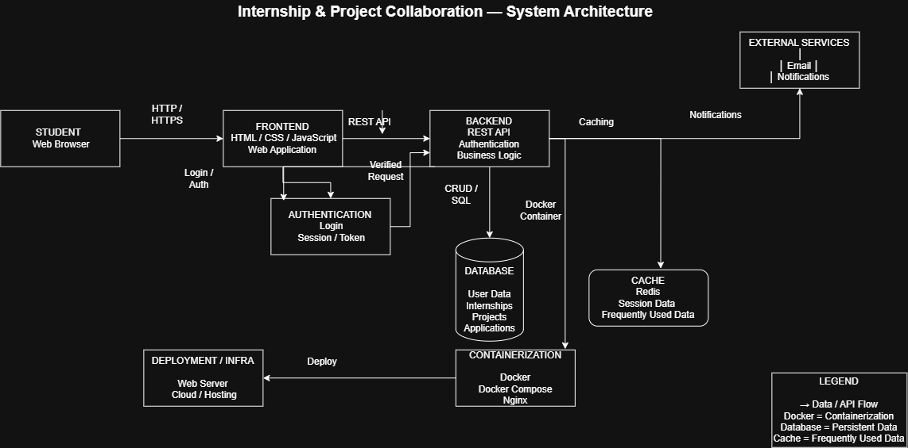

# Internship and Project Collaboration
A centralized platform that connects students, mentors, and organizations to streamline internship discovery, project collaboration, communication, and task management.
---

# Vision Document

## 1. Project Name

**Internship and Project Collaboration**

---

## 2. Project Overview


Internship and Project Collaboration is a web-based platform that helps students discover internship opportunities, collaborate on academic and personal projects, and manage team activities in one place. The platform connects students, mentors, and organizations to improve communication, project management, and skill development.

## 3. Problem it Solves

Students often face several challenges while searching for internships and collaborating on projects:

- Internship opportunities are scattered across multiple websites.
- Finding suitable teammates for projects is difficult.
- Communication between students and mentors is often unorganized.
- Project tasks are managed using multiple applications.
- Tracking project progress becomes inefficient.
- File sharing and documentation are difficult to organize.

These issues reduce productivity and create unnecessary complexity for students and mentors.

The proposed platform solves these problems by providing a centralized system that combines internship management, project collaboration, communication, and task tracking.

---

## 4. Target Users (Personas)

### 1. Students


- Search and apply for internships
- Create or join projects
- Collaborate with teammates
- Track assigned tasks
- Share project documents
- Communicate with mentors

* **Role & Motivation:** Looking to gain practical experience, discover verified internship opportunities, and build strong project portfolios.
* **Core Needs:**
  * Simple discovery of internships matching skills and interests.
  * Frictionless tools to form teams, recruit peers, and manage academic or personal projects.
  * Direct access to mentor guidance and feedback.

### 2. Mentors (Faculty & Industry Professionals)


- Guide students during projects
- Monitor project progress
- Review submissions
- Provide feedback and suggestions
* **Role & Motivation:** Dedicated to guiding student initiatives, monitoring academic milestones, and nurturing talent.
* **Core Needs:**
  * Dashboards to monitor multiple project teams and track progress asynchronously.
  * Efficient feedback channels like inline comments and milestone sign-offs.
  * Direct line of communication with student teams without cluttering personal email channels.

### 3. Organizations (Companies & Startups)

- Post internship opportunities
- Review student applications
- Select candidates
- Communicate with applicants

* **Role & Motivation:** Seeking verified, high-quality student talent for short-term projects, internships, and entry-level positions.
* **Core Needs:**
  * Streamlined job and internship posting workflows.
  * Applicant filtering based on skills, academic background, and portfolio quality.
  * Centralized management of application reviews and interviews.

---

## 5.  Vision Statement

Bridging the gap between classroom and career, we're building an ecosystem where students learn by doing, mentors guide with impact, and organizations discover talent through hands-on collaboration—not just credentials."

---

## 6. Project Objectives

- Simplify internship discovery.
- Improve collaboration among students.
- Centralize project management.
- Enhance mentor–student interaction.
- Reduce dependency on multiple applications.
- Improve productivity through task tracking.
- Create a collaborative learning environment.

---


## 7. Key Features & Goals


| Feature | Description |
|----------|-------------|
| User Authentication | Secure login and registration |
| Student Profiles | Manage academic and professional information |
| Internship Portal | Browse and apply for internships |
| Organization Dashboard | Post and manage internship opportunities |
| Project Creation | Create collaborative projects |
| Team Management | Invite and manage project members |
| Task Management | Assign, update, and monitor tasks |
| File Sharing | Upload and manage project documents |
| Real-time Notifications | Receive updates and reminders |
| Messaging System | Communicate with teammates and mentors |
| Progress Tracking | Monitor project completion status |


### Internship & Opportunity Hub
* **Posting & Discovery:** Verified organizations can post internships, research positions, and freelance gigs with detailed skill tags.
* **One-Click Application:** Simplified application process linked directly to the student’s platform profile and portfolio.

### Project Creation & Workspace
* **Project Builder:** Open or private workspaces for academic capstones, hackathons, or side projects.
* **Talent Matching:** "Looking for Teammate" flags filtering by specific skills (e.g., Frontend Developer, UI/UX Designer).

### Task & Milestone Management
* **Interactive Boards:** Kanban-style task tracking (To-Do, In Progress, Under Review, Completed).
* **Deadlines & Assignment:** Assign specific tasks to team members with custom sub-tasks and due dates.

### Real-Time Communication & Notifications
* **Team Channels & Direct Messaging:** Contextual chat rooms per project and direct messaging across members.
* **Activity Feeds:** Real-time push and email notifications for task assignments, mentor feedback, and application status updates.

### Mentor Guidance & Asset Sharing
* **Review Request System:** Students can send specific milestones to assigned mentors for formal review.
* **Document Repository:** Centralized, permission-based storage for project documentation, deliverables, and assets.

### Auth & Profile Management
* **Role-Based Access Control (RBAC):** Tailored views and permissions for Students, Mentors, and Organizations.
* **Dynamic Profiles:** Comprehensive portfolio pages showcasing completed projects, verified internships, and endorsements.

---

## 8. Success Metrics

* **User Growth:** Steady month-over-month platform growth in Monthly Active Users (MAU) and new registrations.
* **Engagement:** High user retention and active daily collaboration measured by session duration and messaging volume.
* **Internship Pipeline:** High conversion rate from initial applications to successful candidate placements.
* **Project Velocity:** Higher on-time milestone completion rate and measurable reduction in project management delays.
* **Satisfaction:** Strong Net Promoter Score (NPS) and positive feedback across all user roles.

---

## 9. Assumptions 
- Users have internet connectivity.
- Students regularly update their profiles.
- Organizations actively post internship opportunities.
- Mentors participate in project guidance.
- Users possess basic digital literacy.

---

## 10. Constraints

- Internet connection is required.
- User authentication is mandatory.
- Data privacy and security must be maintained.
- Initial release may support only educational institutions.
- Platform performance depends on server availability.

---

## 11. Future Scope

Future enhancements may include:

- AI-based internship recommendations.
- Resume analysis and improvement suggestions.
- Video interview scheduling.
- Integrated coding assessments.
- Mobile application.
- Calendar integration.
- Real-time collaborative document editing.
- Analytics dashboard for institutions.
- Internship recommendation engine using Machine Learning.

---

## 12. Proposed Technology Stack

| Component | Technology |
|-----------|------------|
| Frontend | HTML, CSS, JavaScript, React |
| Backend | Node.js / Express |
| Database | MongoDB |
| Authentication | JWT / OAuth |
| Version Control | Git & GitHub |
| Deployment | Vercel / Render |

---

## 13. Conclusion

Internship and Project Collaboration aims to provide a unified platform that simplifies internship management and project collaboration for students, mentors, and organizations. By integrating communication, task management, document sharing, and internship opportunities into a single system, the platform improves efficiency, collaboration, and overall user experience.

---

# Software Design

## 1. High-Level System Architecture

The **Internship and Project Collaboration** platform is engineered using a **3-Tier Layered Architecture** adhering to the **Service-Repository Pattern**. This style provides complete separation of concerns between user interface presentation, business domain logic, and data persistence, ensuring high maintainability, independent testability, and seamless horizontal scalability.



- **Editable Draw.io Source:** [docs/design/system_architecture.drawio](docs/design/system_architecture.drawio)
- **High-Resolution PNG Diagram:** [docs/design/system_architecture.png](docs/design/system_architecture.png)

### Key Architecture Layers:
1. **Presentation Tier (Client Layer):** Responsive Single Page Application (SPA) built with React and modular components for Students, Mentors, and Organization Recruiters.
2. **Gateway & Security Tier:** Nginx reverse proxy providing SSL termination, CORS handling, rate limiting, and JWT-based Role-Based Access Control (RBAC) middleware.
3. **Application & Business Logic Tier:** Modular Node.js / Express micro-services/services encapsulating domain workflows (`AuthService`, `InternshipService`, `ProjectService`, `ReviewService`, `NotificationService`).
4. **Persistence & Data Tier:** MongoDB document database for dynamic schema support (applications, skill matrices, nested task boards), Redis for fast session caching and rate-limiting, and Cloud Document Storage for resume PDFs and project assets.

---

## 2. Core Design Principles Applied

The software architecture strictly adheres to fundamental software engineering design principles:

* **Abstraction:** Domain boundaries and third-party dependencies are abstracted behind high-level interfaces and Data Transfer Objects (DTOs). The client communicates with standard REST endpoints without needing knowledge of database schemas, caching layers, or external notification dispatchers.
* **Modularity:** The codebase is partitioned into distinct, self-contained functional modules (Auth, Internships, Projects, Reviews, Notifications). Each module operates independently with its own routes, validation logic, and services.
* **High Cohesion:** Every class, controller, and service adheres to the Single Responsibility Principle (SRP). For example, controllers handle only HTTP parsing and responses, while services manage business validation, ensuring classes have single, focused purposes.
* **Low Coupling:** Subsystems interact via well-defined REST contracts, dependency injection, and event dispatchers. Changes in the persistence layer or external email providers do not ripple into UI components or core business logic.

---

## 3. Key Design Decisions & Rationale

1. **RESTful JSON API Architecture:** Selected for standard HTTP verb mapping, stateless request lifecycles, optimal caching, and universal interoperability with web, mobile, and third-party university systems.
2. **Stateless JWT Authentication with RBAC:** Eliminates server-side session memory bottlenecks, enabling frictionless horizontal scaling while securely enforcing distinct student, faculty, and employer permissions.
3. **MongoDB Document Store:** Chosen over rigid relational tables due to the polymorphic and hierarchical nature of project task boards, evolving skill tags, dynamic resume attributes, and milestone feedback threads.
4. **Component-Driven Modular UI:** Built with reusable UI design tokens and components (cards, filters, badge indicators, modals) ensuring visual consistency, rapid development, and effortless state isolation.
5. **Docker Containerization:** Guarantees absolute development-to-production parity by bundling Nginx, the application runtime, and database services into standardized container environments.

---

## 4. User Interface & Wireframe Designs

The platform UI is structured around 6 core user-centric workflows designed for minimal cognitive load, responsive layout, and immediate visual feedback:

| Screen # | Screen Name | Description & Primary Features | Asset Link |
|:---:|---|---|:---:|
| **01** | **Login & Auth** | Clean split-screen authentication with institutional role toggle and fast error validation. | [View Screen](docs/design/screens/01_login_screen.png) |
| **02** | **Student Dashboard** | Personalized landing hub displaying active applications, project progress, and recommended opportunities. | [View Screen](docs/design/screens/02_student_dashboard.png) |
| **03** | **Browse Internships** | Faceted multi-tag search, location/stipend filters, and opportunity preview cards. | [View Screen](docs/design/screens/03_browse_internships.png) |
| **04** | **Project Collaboration** | Collaborative workspace featuring Kanban task boards, milestone tracking, and team roster. | [View Screen](docs/design/screens/04_project_collaboration.png) |
| **05** | **Student Profile** | Dynamic portfolio editor with skills matrix, PDF resume manager, and application status tracker. | [View Screen](docs/design/screens/05_student_profile.png) |
| **06** | **Faculty Dashboard** | Mentor supervision portal with student activity monitoring, milestone approval workflows, and quick actions. | [View Screen](docs/design/screens/06_faculty_dashboard.png) |

- **All UI Screens Directory:** [docs/design/screens/](docs/design/screens/)

---
## Development Setup

### Branching Strategy

This project follows an organized, multi-branch Git workflow:

```text
main (Unified Full-Stack Production Integration)
  ├── frontend (Frontend Client UI & Single Page Application)
  ├── backend (REST API Server & Data Persistence Layer)
  └── feature/docker-setup (Docker & Nginx Containerization)
```

- **`main`**: The primary production-ready branch containing the complete integrated full-stack application (frontend + backend + docs + database).
- **`frontend`**: Focused client-side branch containing the modular SPA UI ([`app/index.html`](app/index.html), [`app/app.js`](app/app.js), [`app/styles.css`](app/styles.css)) and design assets.
- **`backend`**: Dedicated backend service branch containing the Node.js REST API engine ([`server.js`](server.js)), database schemas ([`data/db.json`](data/db.json)), and server configurations.
- **`feature/docker-setup`**: Containerization infrastructure containing the Dockerfile and Docker Compose definitions.

---

### Quick Start – Local Development

#### Prerequisites

- **Node.js**: v18.0.0 or higher
- **Git**
- *(Optional)* **Docker Desktop & WSL 2** for containerized deployments

#### 1. Clone the Repository

```bash
git clone https://github.com/meetsrishti14/Internship-and-Project-Collaboration.git
cd Internship-and-Project-Collaboration
```

#### 2. Native Node.js Launch (Recommended)

Run the full-stack development server with built-in REST API backend and JSON database persistence:

```bash
npm start
# or directly: node server.js
```

Open your browser and navigate to:

```text
http://localhost:8080/
```

#### 3. Ready-to-Use Demo Login Credentials

The initial login gateway requires selecting your role first. Use any of the pre-configured accounts:

| Role | Email | Password | Accessible Views & Features |
|:---|:---|:---|:---|
| **Student** | `srishti.jain2024@vitstudent.ac.in` | `StudentPass123!` | Dashboard, Browse Internships, Capstone Workspace, My Profile, Academic & Placement Evaluation Report (Printable PDF) |
| **Faculty Mentor** | `faculty@vit.ac.in` | `FacultyPass123!` | Supervision Portal, Milestone Evaluation Queue, Supervised Capstones Roster, Viva Defense Scheduler, Capstone Assessment Sheet |
| **Corporate Recruiter** | `recruiter@hyperscale.ai` | `RecruiterPass123!` | Talent Acquisition Pipeline (Kanban), Posted Job Openings, Candidate Interview Scheduler, Formal Offer Extension, Hiring Funnel Analytics |

---

#### 4. Run Using Docker (Optional)

##### Build the Docker Image:
```bash
docker build -t internship-portal .
```

##### Run the Container:
```bash
docker run -d -p 8080:80 --name internship-portal-container internship-portal
```

##### Or Using Docker Compose:
```bash
docker compose up --build
```

To stop Docker Compose:
```bash
docker compose down
```

---

### Local Development Tools

| Tool | Purpose |
|------|---------|
| Visual Studio Code | Code editing and project development |
| Git & GitHub | Distributed version control and collaboration |
| Node.js & Express | REST API backend server and static asset delivery |
| Docker Desktop & WSL 2 | Containerization and deployment parity |
| Nginx | Web server used inside the Docker container |
